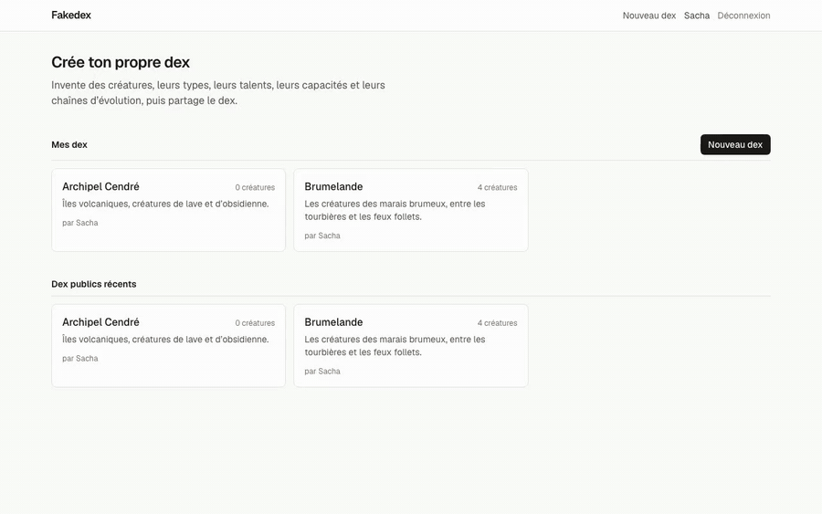

# Fakedex

Crée ton propre dex, comme Archidekt pour les decks Magic : un dex regroupe des créatures rangées par catégories, avec leurs types, talents, capacités et chaînes d'évolution. Connexion avec Google via Supabase Auth.



[Vidéo de la démo en MP4](docs/demo.mp4) (55 s)

Stack : Next.js 16 (App Router, Server Actions), Tailwind CSS 4, Supabase (Postgres + RLS, Auth, Storage).

## Modèle de données

`supabase/migrations/20261111120000_init.sql`

- `profiles` : un par compte, rempli depuis Google au premier login (nom, avatar).
- `dexes` : appartient à un utilisateur (`owner_id`), public ou privé.
- Dans un dex : `categories`, `types`, `type_matchups` (table des types ×0 / ×½ / ×2), `abilities` (talents), `moves` (capacités : type, physique/spéciale/statut, puissance, précision, PP), `creatures` (numéro, image, description, 2 types, taille, poids, 6 stats).
- Liaisons : `creature_abilities` (talent caché ou non), `creature_moves` (niveau, CT, œuf, maître), `evolutions` (arête « A évolue en B » avec déclencheur ; une créature a au plus un parent, les branches sont permises).

Toutes les tables d'un dex ont une clé étrangère composite `(id, dex_id)` : une créature ne peut pas pointer vers le type d'un autre dex. RLS : lecture si le dex est public ou à toi, écriture seulement par le propriétaire. Les images vont dans le bucket `creature-images`, sous `<user id>/<dex id>/`.

## Lancer en local

```sh
pnpm install
supabase start          # ports 553xx, pour ne pas gêner les autres projets
cp .env.example .env.local   # puis colle la clé publishable affichée par `supabase status`
pnpm dev                # http://localhost:3030
```

### Login Google

1. Google Cloud console → APIs & Services → Credentials → OAuth client ID, type « Web application ».
2. Authorized redirect URI : `http://127.0.0.1:55321/auth/v1/callback` en local, `https://<ref>.supabase.co/auth/v1/callback` en prod.
3. `cp supabase/.env.example supabase/.env`, remplis l'ID et le secret, puis `supabase stop && supabase start`.

En prod : active Google dans Supabase → Authentication → Providers, et ajoute `https://<ton domaine>/auth/callback` aux Redirect URLs.

Après un changement de schéma : `supabase gen types typescript --local > src/lib/supabase/database.types.ts`.
